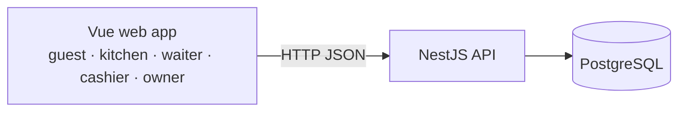

# TableQR

**QR ordering at every restaurant table — fair kitchen queue, VietQR payment, per-restaurant house rules.**

| Screen 1                                | Screen 2                                |
| --------------------------------------- | --------------------------------------- |
|  |  |

## Quick start

Requires: Node ≥ 24 and Docker (Postgres runs in a container on port 55432).

```sh
make install   # dependencies
make dev       # infrastructure, migrations, API and web together
```

Open http://localhost:5310 (web); the API listens on http://127.0.0.1:3310. Optional: `cp .env.example .env` to override settings. `make help` lists every command.

The platform admin (suspends abusive restaurants at `/quan-tri`) has no sign-up screen; create one with `cd services/api && TQR_ADMIN_PASSWORD='…' npm run admin:create -- --email admin@example.com` (the password is read from the environment and never printed).

## Features

- **Owner:** self sign-up, house rules (pay before/after eating, who opens a table, order approval, portions per person, kitchen reminder time), VietQR bank account, menu with kitchen stations, tables with printable QR codes, staff accounts per role.
- **Guest (phone, no app):** scan the table QR, party size, order, live status per dish, bill with a VietQR code that follows new orders, online table booking at `/r/<slug>/dat-ban`.
- **Kitchen (`/bep`):** one queue per station, oldest first; overtaking the same dish needs a reason; "Bật đọc to" reads new orders aloud in Vietnamese ("Bàn 1: hai phở bò, một trà đá") and reminds dishes waiting too long (5–20 min, set by the owner), offline on the iPad's own voice.
- **Owner:** self sign-up, house rules (pay before/after eating, who opens a table, order approval, portions per person), optional VietQR transfer payment (off by default; turn it on with a bank account), menu with kitchen stations, tables with printable QR codes, staff accounts per role.
- **Guest (phone, no app):** scan the table QR, party size, order, live status per dish, bill that follows new orders ("Thanh toán tại quầy", or a VietQR code when the restaurant turned QR payment on), online table booking at `/r/<slug>/dat-ban`.
- **Kitchen (`/bep`):** one queue per station, oldest first; overtaking the same dish needs a reason.
- **Waiter (`/phuc-vu`):** ready dishes per table, unusual orders to confirm (`/phuc-vu/duyet`).
- **Cashier (`/thu-ngan`):** confirm payment against the bill code ("Đã nhận tiền" at the counter; "Đã nhận chuyển khoản" too when QR payment is on), close tables.

Results of release 1: [docs/delivery/001-qr-table-ordering/demo.md](docs/delivery/001-qr-table-ordering/demo.md).

## Demo video

`make demo-video` records a ~3-minute Vietnamese demo for restaurant owners, shown on a phone (sign-up, menu, tables and QR, settings, a kitchen account, a guest ordering at Bàn 1, the kitchen reading the order aloud and its 10-minute reminder, serving, paying at the counter). It needs the dev server running (`make dev`; or set `DEMO_BASE_URL`), macOS (`say -v Linh` voices the narration and the kitchen's spoken sentences) and ffmpeg. Each run signs up a new invented restaurant ("Bún Chả Hương Liên", `demo-…@example.com`).

Output in `docs/delivery/001-qr-table-ordering/video/` (`DEMO_OUT` to change): `tableqr-demo-dien-thoai.mp4` (1080×1920, H.264 + AAC; not committed), `cover.jpg` and `tableqr-demo-dien-thoai.srt`. Scratch files go to `$TMPDIR/tableqr-demo-video` (`DEMO_WORK`). The scenes and actions live in `scripts/demo-video/record.mjs`, the narration words in `scripts/demo-video/narration.mjs`, the frame, cards and audio mix in `scripts/demo-video/compose.mjs`; after a UI change, fix the locator that failed (the run saves `failed-<phone>.png` in the work folder) and run it again.

## Architecture



Details: [docs/architecture/README.md](docs/architecture/README.md) · decisions: [docs/adr](docs/adr) · conventions: [docs/conventions.md](docs/conventions.md) · tests: [docs/testing.md](docs/testing.md).

## Quality

`make ci` = lint + typecheck + unit tests + e2e (real Postgres via Testcontainers, Playwright on iPhone and iPad) for every part (thresholds in `docs/testing.md`); GitHub Actions runs the same. Commits follow Conventional Commits (scopes in `commitlint.config.mjs`), enforced by husky + commitlint.

## Structure

```
services/api/  API — NestJS, Drizzle, PostgreSQL, ESLint, Vitest
web/           web app — Vue 3 (TS strict, ESLint, Stylelint, Vitest, Playwright)
deploy/        production header set and an nginx example (SPA + /api proxy; see docs/security.md)
docs/          plan, ADRs, architecture, conventions, testing, screenshots
```

## Licence and data

Private project. No real guest data in the repo; seeds are fictional.
