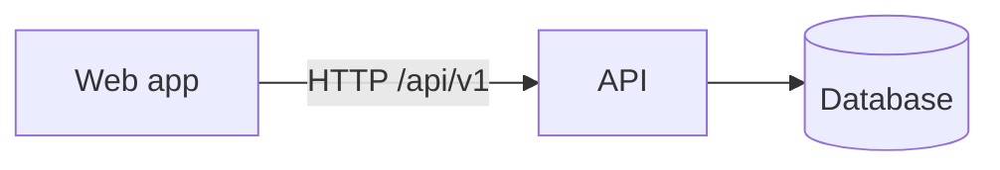

# TableQR

**QR ordering at every restaurant table — fair kitchen queue, VietQR payment, per-restaurant house rules.**

| Screen 1                                | Screen 2                                |
| --------------------------------------- | --------------------------------------- |
|  |  |

## Quick start

Requires: Node ≥ 24, Docker (for local infrastructure), and for a Python backend Python 3.12 + [uv](https://docs.astral.sh/uv/).

```sh
make install   # dependencies
make dev       # infrastructure, migrations, API and web together
```

`make help` lists every command.

## Features

- …

## Architecture



Details: [docs/architecture/README.md](docs/architecture/README.md) · decisions: [docs/adr](docs/adr) · conventions: [docs/conventions.md](docs/conventions.md) · tests: [docs/testing.md](docs/testing.md).

## Quality

`make ci` = lint + typecheck + test for every part (thresholds in `docs/testing.md`); GitHub Actions runs the same. Commits follow Conventional Commits (scopes in `commitlint.config.mjs`), enforced by husky + commitlint.

## Structure

```
services/api/  API — NestJS, Drizzle, PostgreSQL, ESLint, Vitest
web/           web app — Vue 3 (TS strict, ESLint, Stylelint, Vitest, Playwright)
docs/          plan, ADRs, architecture, conventions, testing, screenshots
```

## Licence and data

Private project. No real guest data in the repo; seeds are fictional.
