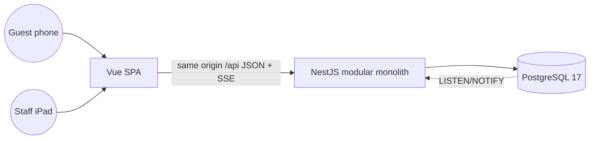

# Architecture

One deployable API (modular monolith) and one SPA served from the same origin. Contexts inside the API:
service floor (core: sessions, orders, kitchen queue, serving), billing (bills, VietQR, payments), booking,
restaurant setup (menu, tables, house rules), identity (users, roles, sessions) and a realtime hub. Each
context keeps its pure rules in `domain/` (no framework imports) and talks to Postgres through repositories
that take the tenant id first. Details and data model:
[`docs/delivery/001-qr-table-ordering/design.md`](../delivery/001-qr-table-ordering/design.md).

## Boundaries

| Boundary               | Contract                                                             | Owner   |
| ---------------------- | -------------------------------------------------------------------- | ------- |
| web → api              | OpenAPI generated by the API, RFC 9457 problems with a stable `code` | api     |
| api → browser streams  | SSE events `snapshot` / `delta` / `resync` (ADR 0004)                | api     |
| api → guest's bank app | VietQR EMVCo payload (ADR 0006)                                      | billing |

## Cross-cutting

- Config from environment (`TQR_*`), validated at boot; `.env.example` complete.
- Tenancy: tenant id only from the authenticated principal (ADR 0003).
- Auth: cookie sessions on one origin (ADR 0002).
- Errors: RFC 9457 problem details with a stable `code`; mapped once at the boundary.
- Observability: structured JSON logs with request id, PII redacted; `/health` checks the database.

## Decisions

[0001 stack](../adr/0001-stack-and-layout.md) · [0002 auth](../adr/0002-same-origin-api-and-cookie-sessions.md) · [0003 tenancy](../adr/0003-tenant-scoping.md) · [0004 realtime](../adr/0004-realtime-sse-with-postgres-notify.md) · [0005 queue order](../adr/0005-kitchen-queue-order.md) · [0006 VietQR](../adr/0006-vietqr-payload-and-manual-confirmation.md) · [0007 booking overlap](../adr/0007-booking-overlap-by-exclusion-constraint.md)
