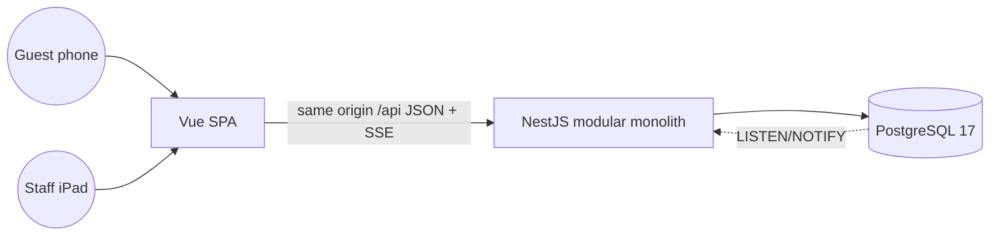

# Architecture

One deployable API (modular monolith) and one SPA served from the same origin. Contexts inside the API:
service floor (core: sessions, orders, kitchen queue, serving), billing (bills, VietQR, payments), booking,
restaurant setup (menu, tables, house rules), identity (users, roles, sessions) and a realtime hub. Each
context keeps its pure rules in `domain/` (no framework imports) and talks to Postgres through repositories
that take the tenant id first. Details and data model:
[`docs/delivery/001-qr-table-ordering/design.md`](../delivery/001-qr-table-ordering/design.md).

## Boundaries

| Boundary               | Contract                                                                              | Owner   |
| ---------------------- | ------------------------------------------------------------------------------------- | ------- |
| web → api              | OpenAPI generated by the API, RFC 9457 problems with a stable `code`                  | api     |
| api → browser streams  | SSE events `snapshot` / `delta` / `resync` (ADR 0004), `heartbeat` / `bye` (ADR 0010) | api     |
| api → guest's bank app | VietQR EMVCo payload (ADR 0006), only when the restaurant turned QR on (ADR 0008)     | billing |

## Stream liveness (ADR 0010)

Every stream sends `heartbeat` `{intervalMs}` after its first snapshot and every `TQR_SSE_HEARTBEAT_MS` (15 s). `web/src/composables/useStream.ts` treats 2.5 heartbeats without any event as a dead stream (an API gone behind a proxy leaves EventSource "open"): it closes it, shows `reconnecting` and reopens with jittered backoff capped at 10 s (1, 2, 5, 10 s steps); the reconnect snapshot repairs state. A `revoked` stream, or a 401 when the browser gave up, ends it (`ended`) and sends staff to sign-in instead. Every screen that follows a stream shows `StreamBanner` ("Mất kết nối — đang kết nối lại…") meanwhile. On shutdown `StreamGate.beforeApplicationShutdown` sends `bye` and ends every stream, so `app.close()` never waits for a browser.

## Kitchen voice (ADR 0009)

`web/src/features/kitchen/voice/`: pure deciders — `arrivals.ts` (new dishes, deduped by item id, so a reconnect never re-reads), `scheduler.ts` (overdue reminders on the server-corrected clock), `phrases.ts` (Vietnamese sentences, reminders grouped per table) — wired to a station's live queue by `useVoiceAnnouncements.ts`, plus `useConnectionVoice.ts` ("Mất kết nối máy chủ" / "Đã kết nối lại"). They only decide what to say; `speech-queue.ts` says one sentence at a time through the `SpeechEngine` port, whose adapter `browser-speech.ts` is the device's own `speechSynthesis` (`vi-VN`, voice "Linh"; offline, no service of ours). The API's only part is the station queue (`reminder` rule, `serverTime`) and its stream.

## Cross-cutting

- Config from environment (`TQR_*`), validated at boot; `.env.example` complete.
- Tenancy: tenant id only from the authenticated principal (ADR 0003).
- Auth: cookie sessions on one origin (ADR 0002).
- Errors: RFC 9457 problem details with a stable `code`; mapped once at the boundary.
- Observability: structured JSON logs with request id, PII redacted; `/api/health` checks the database.

## Decisions

[0001 stack](../adr/0001-stack-and-layout.md) · [0002 auth](../adr/0002-same-origin-api-and-cookie-sessions.md) · [0003 tenancy](../adr/0003-tenant-scoping.md) · [0004 realtime](../adr/0004-realtime-sse-with-postgres-notify.md) · [0005 queue order](../adr/0005-kitchen-queue-order.md) · [0006 VietQR](../adr/0006-vietqr-payload-and-manual-confirmation.md) · [0007 booking overlap](../adr/0007-booking-overlap-by-exclusion-constraint.md) · [0008 QR optional](../adr/0008-qr-payment-optional.md) · [0009 kitchen voice](../adr/0009-kitchen-voice-browser-speech.md) · [0010 stream liveness](../adr/0010-stream-liveness-and-graceful-shutdown.md)
