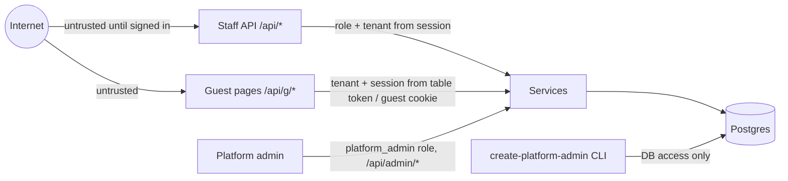

# Security — threat model and controls

Updated: 2026-11-08 · Level: OWASP ASVS 5.0 L1 for everything, L2 for authentication and the payment path (money).

## Assets

| Asset                                         | Why it matters                                                     |
| --------------------------------------------- | ------------------------------------------------------------------ |
| Tenant data (menu, orders, bills, revenue)    | competitors or other tenants must not see it                       |
| Payment confirmations                         | a false "paid" loses the restaurant money                          |
| Restaurant bank account in the VietQR payload | tampering redirects guests' money                                  |
| Staff credentials and sessions                | full control of a restaurant                                       |
| Guest booking name + phone                    | personal data (Vietnam Decree 13/2023 on personal data protection) |
| Kitchen queue integrity                       | the product's promise (fairness)                                   |

## Entry points and trust boundaries

## Threats and controls

| Threat (STRIDE)        | Example                                             | Control                                                                                                          | Test                       |
| ---------------------- | --------------------------------------------------- | ---------------------------------------------------------------------------------------------------------------- | -------------------------- |
| Spoofing               | guest orders from home with a photo of the QR       | session opening rule (staff opens / self check-in), anomaly hold, staff can close sessions, QR rotation (AC10)   | e2e AC19, AC10             |
| Spoofing               | credential stuffing on staff sign-in                | scrypt hashes, 10 failures / 15 min per email → block (AC4), generic error text                                  | e2e AC4                    |
| Tampering              | guest changes the price in the request              | server recomputes totals from the menu; client price mismatch → reject (AC25)                                    | e2e AC25                   |
| Tampering              | someone edits the bank account to theirs            | only owner role edits bank details; change is audit-logged and shown on the cashier screen for 24 h              | e2e role matrix            |
| Tampering              | guest pays a reduced amount by editing the transfer | cashier confirms against amount + memo; bill shows exact amount                                                  | manual check in demo       |
| Repudiation            | "I never confirmed that payment"                    | payments store who/when/method; served items store who/when                                                      | e2e AC44, AC36             |
| Information disclosure | tenant A reads tenant B's bill by id (BOLA)         | ADR 0003 scoping, composite FKs, 404                                                                             | isolation e2e matrix       |
| Information disclosure | logs leak phone numbers or tokens                   | logger redacts `authorization`, `cookie`, `phone`, `guestName`, `password`; no request bodies in logs            | unit test of the redaction |
| Denial of service      | order spam from one phone                           | per-device rate limit (20 orders / 10 min), cart limits (AC22), body limit 32 kB, SSE stream caps                | e2e                        |
| Elevation of privilege | kitchen account confirms payments (BFLA)            | role guard deny-by-default per route + service-level check                                                       | e2e AC15 role matrix       |
| Elevation of privilege | an owner calls the platform admin API               | `platform_admin` role only; admin has no restaurant and gets 403 on tenant endpoints; created only by the CLI    | `test/roles.e2e-spec.ts`   |
| Elevation of privilege | a fired employee keeps working on an old session    | disable / new password delete the person's `auth_sessions` rows in the same transaction; role read per request   | e2e AC16                   |
| Denial of service      | an owner locks themselves or everyone out           | no self disable/demote/reset; restaurant row lock keeps ≥ 1 active owner                                         | e2e AC16, unit rules       |
| Spoofing               | staff of an abusive restaurant keep using it        | suspend deletes the restaurant's sessions; sign-in refused (`RESTAURANT_SUSPENDED`, only after a right password) | e2e AC54                   |
| CSRF                   | a malicious page posts to `/api/bills/:id/pay`      | SameSite=Lax cookies + `Origin` check on non-GET + JSON only                                                     | e2e                        |
| XSS                    | a menu item name with `<script>`                    | Vue escapes by default; no `v-html`; CSP `default-src 'self'`                                                    | lint rule `vue/no-v-html`  |

## Baseline controls

- Settings validated at boot (`src/config/settings.ts`); `.env` never committed; `TQR_SESSION_SECRET` ≥ 32 chars.
- Headers in production: CSP `default-src 'self'; img-src 'self' data:; frame-ancestors 'none'`, HSTS, `X-Content-Type-Options: nosniff`, `Referrer-Policy: same-origin`.
- Input validated with zod at the boundary; unknown keys rejected; list endpoints capped at 200.
- `npm audit --omit=dev` in CI (added with the first feature item); lockfiles committed; install scripts not allowed unless reviewed.
- Personal data: booking name and phone deleted 30 days after the booking slot; no guest accounts; no analytics trackers.

## Before first deploy

- [ ] Security headers verified with a scan
- [ ] Backups + tested restore
- [ ] Secret rotation procedure in the runbook
- [ ] RLS hardening reconsidered (ADR 0003)
